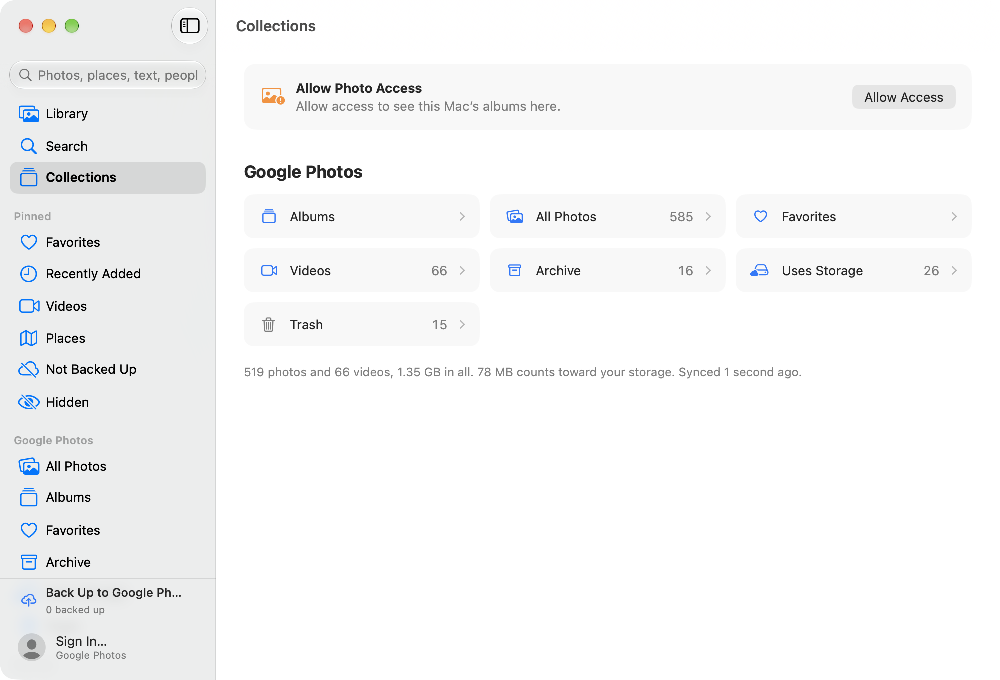
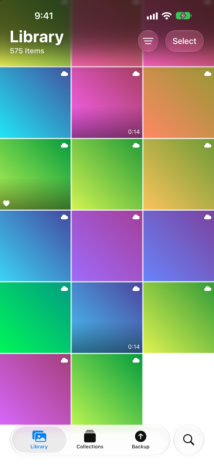
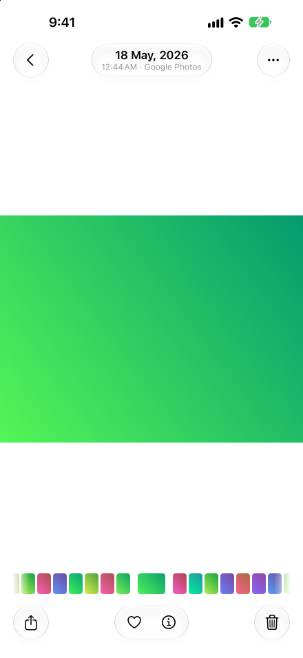
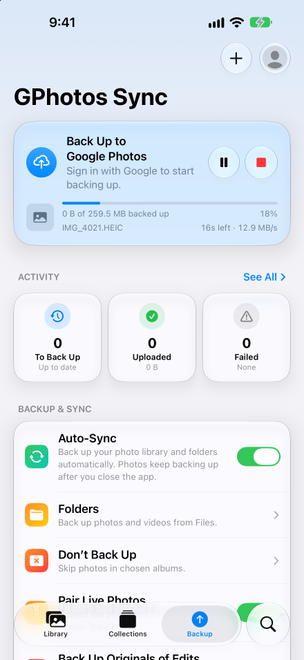
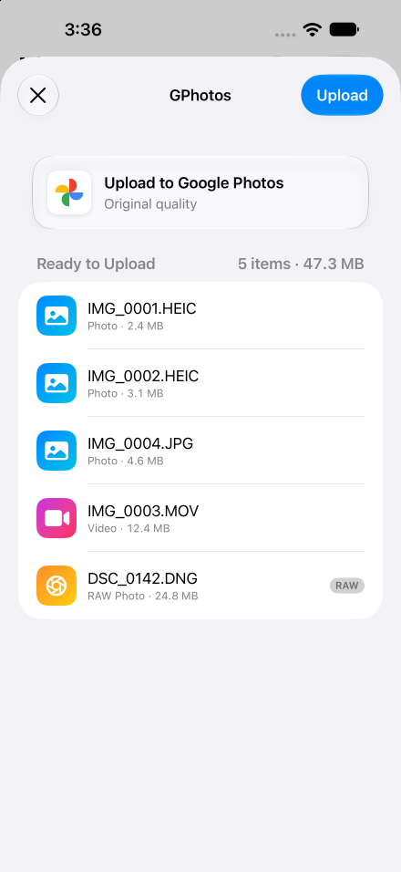

# GPhotos

A small, fast, native Mac app that backs up your photos and videos to Google Photos in
original quality. It's a 6 MB download. Point it at your folders, drop files on it, and
browse your Mac's and Google's photos in one library.

GPhotos is written in Swift and SwiftUI. There's no bundled web runtime and nothing to
install alongside it. It watches folders with FSEvents, draws its grid with one Core
Animation layer per visible cell, and is tested with 100,000 items in the library.
Uploads go straight from your Mac to Google, with no server of ours in between.

An iPhone and iPad companion backs up the Photos library and folders from Files. Both
apps need macOS 27 or iOS 27. They use Google Photos' unofficial mobile interface to
sign in, upload and sync, and uploads count toward your Google Account storage.
GPhotos isn't affiliated with Google.

## Why GPhotos

- **Light.** A 6 MB disk image for Apple silicon. One app with a menu bar extra, a share
  extension and widgets. No helper apps, no bundled browser engine.
- **Original quality.** Photos, videos, RAW files, bursts and Live Photos upload at full
  resolution.
- **Fast on big libraries.** The grid places cells with arithmetic instead of measuring
  them, so its cost doesn't grow with the library. Thumbnails load only for what's on
  screen.
- **Private by default.** Search, people and memories are computed on your device. Your
  credential stays in the Keychain.
- **Careful with your files.** Nothing is deleted until Google Photos confirms it has the
  upload for the account you're using.

## Screenshots

Captured from Debug builds with a generated Google library and simulated uploads, with
no Google account signed in. See [the capture guide](docs/screenshots/README.md) to
reproduce them.

### Mac


| Library (Dark) | Viewer & Floating Info Panel |
| :---: | :---: |
|  |  |

| Collections | Backup (Live Upload) |
| :---: | :---: |
|  |  |

| Folders & Skip Rules | Settings |
| :---: | :---: |
|  |  |

### iPhone

| Library | Library (Dark) | Collections |
| :---: | :---: | :---: |
|  |  |  |

| Viewer & Filmstrip | Media Info | Places Map |
| :---: | :---: | :---: |
|  |  |  |

| Search | Backup (Live Upload) | Share Extension |
| :---: | :---: | :---: |
|  |  |  |

## Features

### Library, Collections and search

- **One library.** Device photos, backed-up folders and Google Photos in one timeline,
  by Years, Months or All. A photo that's both on your device and in Google appears
  once, with a backup badge. Pinch to change the grid, filter, select, and right-click
  for actions. Backed-up folders show even without Photos access.
- **Viewer.** Zoom from the grid into full-screen photos and videos, scrub the
  filmstrip, and play Live Photos. The floating Info panel shows capture dates, camera
  details, location and storage status, and lets you edit captions. Google photos show
  a quick preview first and sharpen in place.
- **Collections.** Pinned items, albums, media types, utilities and a Places map of the
  whole library, Google-only photos included. Hidden items and Google's Locked Folder
  open only after Touch ID, Face ID or your password. Google scopes cover Albums, All
  Photos, Favorites, Videos, Archive, Trash and Uses Storage.
- **Google Photos.** Each account gets a local mirror that syncs in full once and then
  only picks up changes. Stream videos, save originals, edit captions, favorite,
  archive, add to albums, move to Trash or restore. Every destructive action asks first
  and touches only the account you're browsing. Delete Forever works only on items
  already in Trash.
- **Locked Folder.** Move photos to Google's Locked Folder from the library or the
  viewer. GPhotos does this through your photos.google.com session, which you sign in
  to once inside the app, and checks it's the same account first. To move items out,
  open the Locked Folder in Google Photos without leaving the app. Locked Folder photos are
  never saved to disk.
- **On-device search and People.** Search text in photos, places, dates and what Vision
  recognizes, across device and Google-only photos. Browse categories, On This Day,
  trips, similar photos and Google duplicates. Name, hide or merge people. Google-only
  photos are analyzed from a small thumbnail fetched on Wi-Fi, or on cellular if you
  allow it, and the thumbnail isn't kept.
- **Siri, Spotlight and Shortcuts.** Every item is in Spotlight's semantic index, so
  Siri can find "photos of Sam at the beach last summer", open them, share them or add
  them to an album. Shortcuts include Back Up Now, Back Up Files, Backup Status, Search
  Library, Find Photos and Open Album, plus Back Up to Google Photos on iPhone.
  Everything stays on the device.
- **After cleanup.** Photos removed from the device keep a small thumbnail in the
  library while the original loads from Google. Keep Recently Viewed holds back photos
  you opened lately.

### Backup

- **Watched folders on Mac.** Watch any folder and changes are picked up as they happen.
  Files still being copied are left alone until they settle. Live Photos in folders pair
  by Apple's content identifier, so renamed files still pair.
- **iPhone Photos library.** New photos back up on their own, including every burst
  frame, the RAW half of RAW+JPEG shots, and Live Photo motion. Only real changes cause
  work, which keeps battery use low.
- **Skip rules.** Exclude names or wildcards (`CapCut`, `*.tmp`) or whole folders. Items
  already queued that match a new rule are dropped. On iPhone, choose albums to skip.
- **Uploads you pick.** Drop files on the window or the Dock icon, use Share › GPhotos,
  or tap + on iPhone.
- **Albums.** Mirror your Photos albums (iPhone) or name albums after folders. Albums
  past Google's 20,000-item limit continue in "Name (2)".
- **More accounts.** The primary account backs up as usual. Each extra account gets its
  own copy, uploaded only while your iPhone charges or your Mac is plugged in and idle.
- **Reliable.** Uploads resume after network drops, retry with backoff, and keep going
  on battery and in Low Data Mode. On iOS 27 the photo upload extension can run after
  the app is closed, on iOS's schedule.

### Free up space

- **Delete After Backup.** After a delay you choose, remove items that are verifiably in
  Google Photos. With Only When Low on Space, GPhotos waits until less than 5 GB is free
  and removes the oldest items first, only as many as it needs.
- **Folder files** are removed quietly once the delay passes.
- **iPhone Photos items** need one confirmation, because iOS always asks before an app
  deletes photos. They stay in Recently Deleted for 30 days.
- **Protected items.** Favorites, chosen albums and chosen folders are never removed.
- **Checked twice.** An item is removed only after its upload to your current account is
  verified and Google Photos confirms it again, Live Photo motion included. A hash match
  alone doesn't prove original quality, so items found that way need their own setting.
  Edited items, partly uploaded Live Photos or RAW files, incomplete bursts and shared
  iCloud items are always kept. File contents are compared with the upload before
  anything is deleted.

### Stay informed

- **Notifications** when a backup finishes, items fail (with Retry), or an account needs
  you to sign in again. One per batch, and only while the app is in the background.
- **Menu bar** progress on Mac, and a Live Activity on the iPhone Lock Screen and Dynamic
  Island.
- **Widgets** on the Mac desktop and the iPhone Home and Lock Screens: Memories, People
  and Backup status.

### Apps

- **Mac:** a sidebar with search, Library, Collections, Pinned, Albums and Google Photos
  sections, Backup, a sortable Activity table, Folders and Settings. Also a menu bar
  popover, drag and drop, keyboard shortcuts, desktop widgets, Shortcuts and Launch at
  Login through the system's login items.
- **iPhone:** Library, Collections, Search and Backup tabs, plus Activity, Folders, Don't
  Back Up, Protected Items, accounts, a share extension, a Live Activity, widgets and
  Shortcuts. The Library draws its last screen the moment the app opens.

## Download and install

### Mac

Download the DMG (about 6 MB) from
[GitHub Releases](https://github.com/SohelIslamImran/GPhotos/releases), drag GPhotos to
Applications, and open it from there. The app and disk image are signed with Developer
ID, and Apple notarizes the disk image. It needs an Apple silicon Mac.

### iPhone and iPad

Each release includes an unsigned IPA for self-signing. Sign the app and its extensions
with your own identity and profiles, and give them one shared App Group. You can also
build and install from source in Xcode with your Apple Developer team. TestFlight
builds are possible when the maintainer turns them on, after Apple's review.

## Build from source

Install Xcode 27.2 or later and [XcodeGen](https://github.com/yonaskolb/XcodeGen).

```sh
./scripts/build-and-run.sh macos
./scripts/build-and-run.sh ios
```

These commands build without signing. For a runnable build, open the generated `GPhotosSync.xcodeproj`, choose `GPhotosSyncMac` or `GPhotosSync`, and select your own team under **Signing & Capabilities**. Choose a unique `GPHOTOS_BUNDLE_ID` in the project settings if your team needs its own identifiers. The iOS app, share extension, photo upload extension, and widgets must be assigned to the same registered App Group. The Mac uses a team-prefixed App Group.

For a signed command-line Mac build, use your own team and bundle ID.

```sh
DEVELOPMENT_TEAM=YOUR_TEAM_ID GPHOTOS_BUNDLE_ID=com.example.gphotos ./scripts/build-and-run.sh macos
open .build/macos/Build/Products/Debug/GPhotosSyncMac.app
```

Choose **Folders** in the Mac sidebar to set up a watched folder. On iPhone, use **Backup** to set up Photos Library backup or add a folder from Files.

## Development and releases

```sh
xcodegen generate
xcodebuild test -project GPhotosSync.xcodeproj -scheme GPhotosSyncMac \
  -destination 'platform=macOS' CODE_SIGNING_ALLOWED=NO
xcodebuild test -project GPhotosSync.xcodeproj -scheme GPhotosSync \
  -destination 'platform=iOS Simulator,id=<simulator-udid>' \
  -only-testing:GPhotosKitTestsIOS CODE_SIGNING_ALLOWED=NO
```

Generate the project after changing `project.yml` or adding source files. See [AGENTS.md](AGENTS.md) for repository conventions and data safety rules.

GitHub Actions tests both platforms. When release signing is configured, each merge to `main` that changes the app publishes the next version, and a version tag such as `v1.2.0` on `main` publishes that version. See the [release setup](docs/releases.md) for signing, versioning and the optional TestFlight job.

## Architecture

See [the library implementation and roadmap](docs/library-client-plan.md) for current
capabilities, the mobile protocol and remaining work.

| Module | Responsibility |
|---|---|
| `GPhotosKit/Protocol` | Protobuf encoding for the Google Photos mobile API |
| `GPhotosKit/Network` | Google sign-in, token refresh and token binding, mobile API client |
| `GPhotosKit/Upload` | Sync engine, upload worker pool (chunked, resumable, throttled progress), idle-time copies to other accounts |
| `GPhotosKit/Storage` | Transfer manifest (source of truth for uploads and deletions), cleanup planner, keychain |
| `GPhotosKit/Scanner` | Photos export, Live Photos, album mirroring, folder scanning (shared by both apps) |
| `GPhotosKit/Library` | Shared layer-rendered grid, thumbnail pipeline, viewer and Collections |
| `GPhotosKit/Library/Unified` | Merged device, folder and cloud timeline; iPhone launch snapshot |
| `GPhotosKit/Library/Remote` | Per-account SQLite mirror, full/delta sync, cloud media and thumbnail cache |
| `GPhotosKit/Library/Intelligence` | Local Vision analysis, SQLite FTS5 search, people, memories and similarity |
| `GPhotosKit/Library/Siri` | App Intents entities and intents on Siri's photos schemas, Spotlight semantic indexing, onscreen awareness |
| `GPhotosKit/Library/Folders` | Security-scoped folder browsing, file thumbnails and viewer |
| `GPhotosKit/AppGroup` | Settings and the shared queue used by the share extensions |
| `GPhotosKit/Notifications` | Local notifications shared by both apps |
| `GPhotosKit/UI` | SwiftUI components shared by both apps, thumbnails, Live Activity attributes |
| `GPhotosKit/Widgets` | What the widgets show: the app's `WidgetPublisher`, the shared snapshot and widget views |
| `GPhotosSync` / `GPhotosSyncMac` | iPhone and Mac apps |
| `ShareExtension` / `MacShareExtension` | Share extensions |
| `PhotosUploadExtension` | iOS 27 scheduled photo uploads with a background URLSession and upload ledger |
| `BackupWidgets` | iPhone widgets and the Live Activity (Lock Screen and Dynamic Island) |
| `MacWidgets` | Mac desktop widgets |
| `Widgets` | The Memories, People and Backup widgets, built into both widget extensions |

## Sign-in

Open the sign-in sheet and choose **Sign in with Google**, or **Paste a Token**: sign in
to Google in a browser, copy the `oauth_token` cookie and paste it. GPhotos exchanges it
for a Google Photos token and stores that only in the device's Keychain. A raw Android
credential works too, including token-bound ones (`token_binding_alias`).

Add more accounts from the account sheet (iPhone) or Settings › Accounts (Mac). You can
make any account primary, turn Keep a Copy off, or remove it. Removing an account never
deletes anything from Google Photos. While any account keeps a copy, nothing leaves your
devices until that copy is uploaded too.

## Third-party notices

See [third-party notices](THIRD-PARTY-NOTICES) for bundled license terms.
