# GPhotos

GPhotos is an independent, native macOS app for uploading photos and videos to Google Photos. Watch folders, drop files from Finder, and browse your local and cloud media in one library. The native iPhone and iPad companion backs up the Photos library and folders from Files.

Both apps use SwiftUI and Liquid Glass and require macOS 27 or iOS 27. They use Google Photos’ unofficial mobile interface for account sign-in, uploads and library sync. Uploads are configured to count toward Google Account storage. GPhotos is unaffiliated with Google.

## Screenshots

Screens captured from Debug builds with generated Google library data and simulated
uploads, without a Google sign-in. See [the capture guide](docs/screenshots/README.md) to
reproduce them.

### Mac

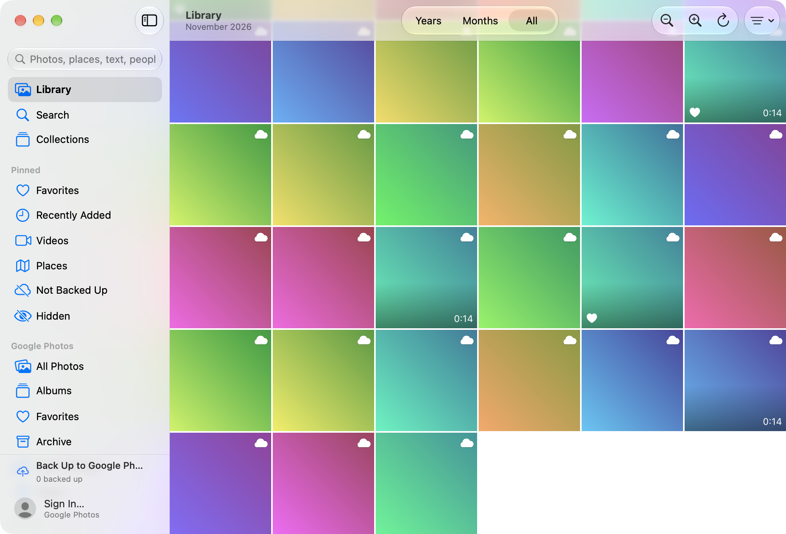

| Library (Dark) | Viewer & Floating Info Panel |
| :---: | :---: |
| 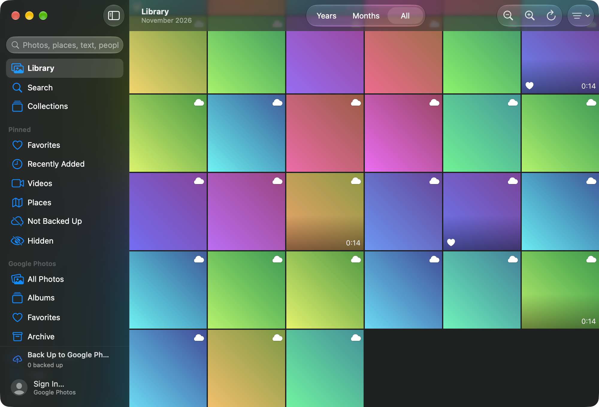 | 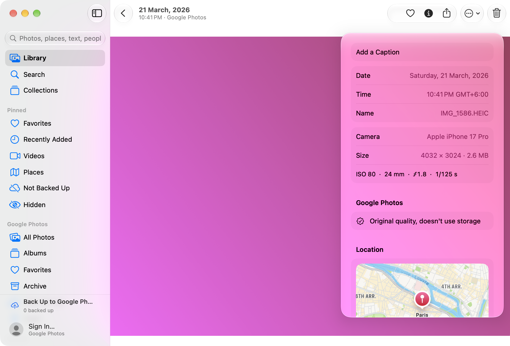 |

| Collections | Backup (Live Upload) |
| :---: | :---: |
|  | 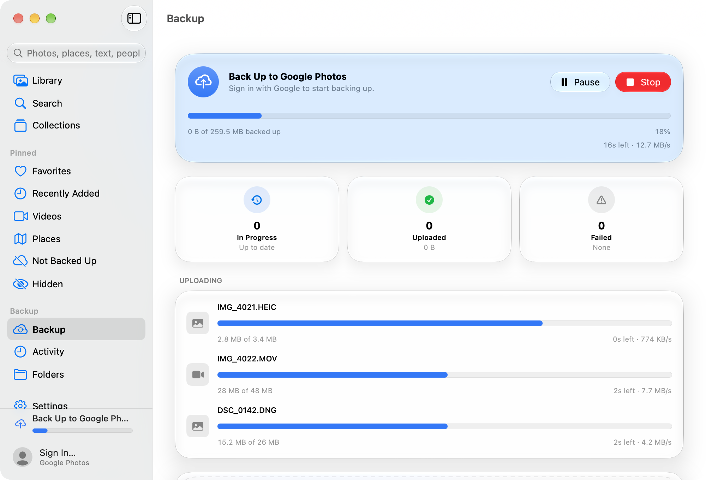 |

| Folders & Skip Rules | Settings |
| :---: | :---: |
| 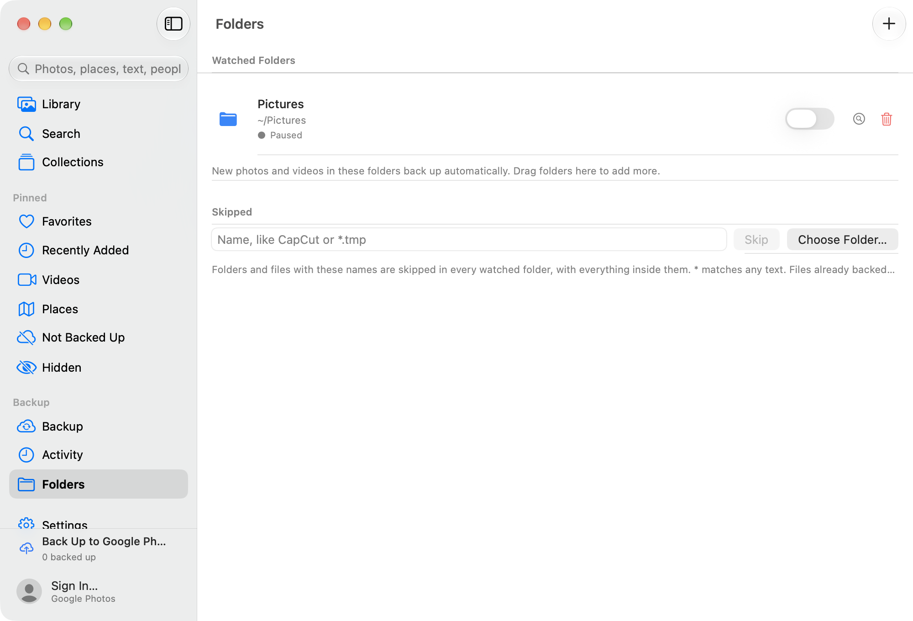 | 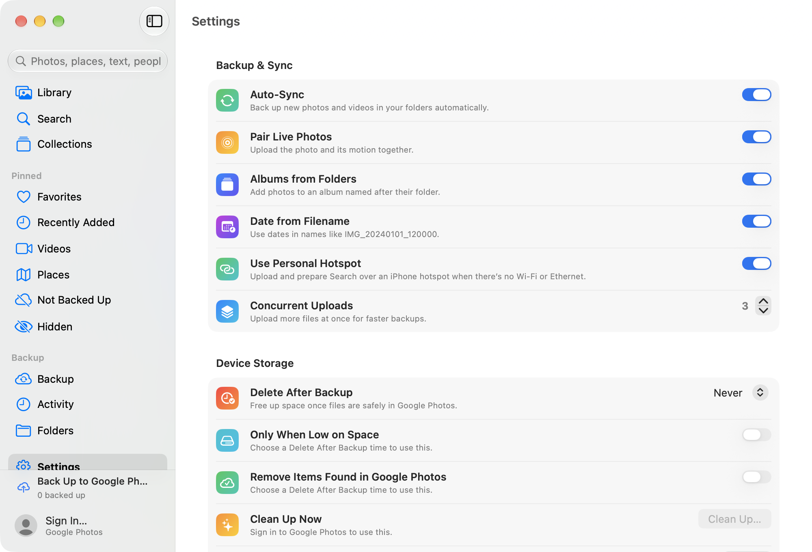 |

### iPhone

| Library | Library (Dark) | Collections |
| :---: | :---: | :---: |
|  | 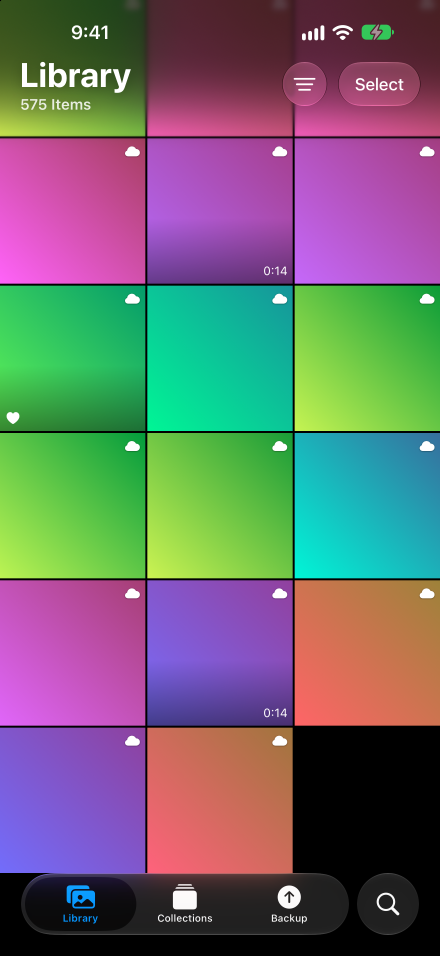 | 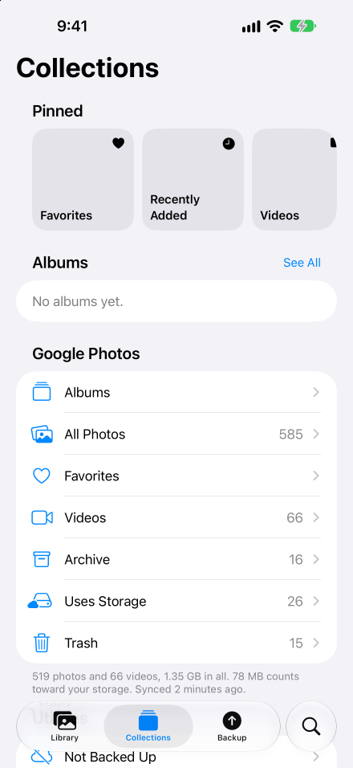 |

| Viewer & Filmstrip | Media Info | Places Map |
| :---: | :---: | :---: |
|  | 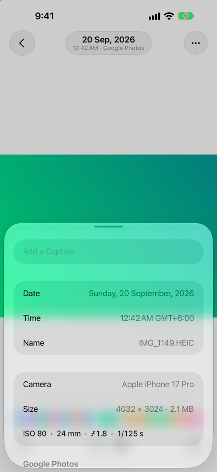 | 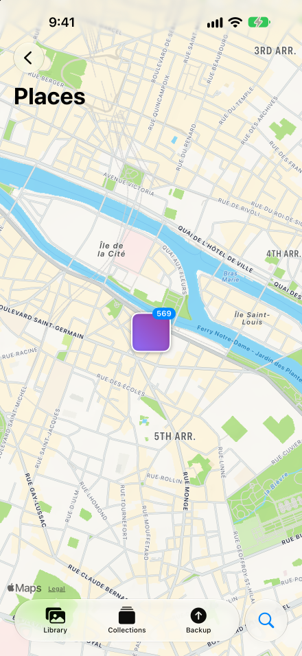 |

| Search | Backup (Live Upload) | Share Extension |
| :---: | :---: | :---: |
| 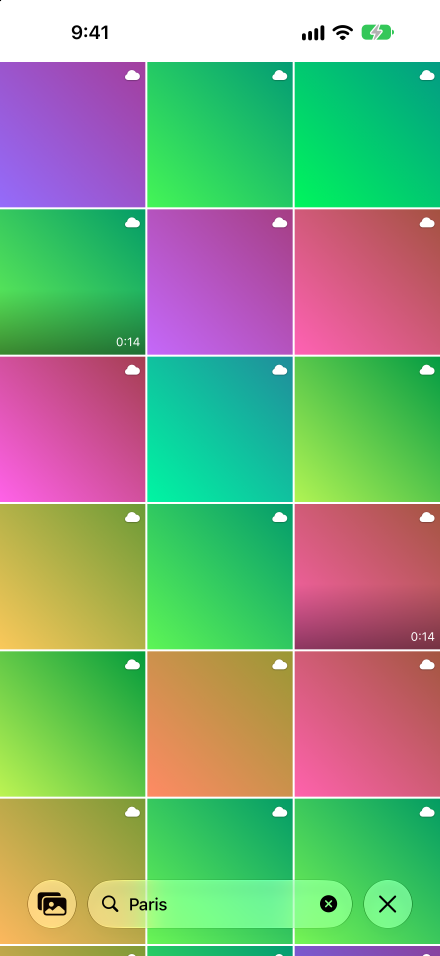 |  |  |

## Features

### Library, Collections and search

- **One Library.** Browse device photos, backed-up folder media and Google Photos in
  Years, Months or All. Matching local and cloud items appear once with backup badges.
  Pinch to change grid density, filter media, select items and open context menus.
  Backed-up folders remain visible without Photos access. On iPhone, drag-to-select
  keeps scrolling while your finger rests near either edge.
- **Viewer.** Zoom out of the grid cell into full-screen photos and videos, scrub the
  filmstrip, zoom natively, play Live Photos, and open the floating Info panel to edit
  captions or inspect capture dates, EXIF camera details, location maps and storage
  status. Google Photos show a quick uncropped preview first and sharpen in place. Share
  or drag exports as needed; folder files can be shared, never deleted from the Library.
- **Collections.** Pinned collections, albums, media types, utilities and an interactive
  Places map across the merged library (including Google-only items). Device Hidden items
  require authentication. Google scopes include Albums, All Photos, Favorites, Videos,
  Archive, Trash and Uses Storage, with charged bytes reported by library sync.
- **Google Photos.** A local mirror per account resumes interrupted full syncs and
  follows with delta updates. Browse cloud items, stream videos, save originals,
  edit captions, favorite, archive, add to albums, move to Trash or restore.
  Destructive actions ask first and affect only the browsed account. Deleting a
  backed-up device item also moves its Google copy to Trash; only items already in Trash
  can be deleted forever (**Delete Forever**).
- **On-device search and People.** Search metadata, text (OCR), places, dates and Vision
  labels across device and Google-only photos—matching everyday concepts, plurals, short
  words, unspaced scripts (CJK/Thai) and Indic marks, with word suggestions ranked by
  photo count. Explore categories, revisit On This Day and trips, and review similar
  photos or Google duplicates. **People** fills in progressively during indexing, levels
  tilted faces, and lets you name, hide or manually merge people. Google-only items are
  analyzed on this device from a small thumbnail each, fetched on Wi-Fi (or on cellular
  with Use Cellular Data on), and never cached for indexing.
- **Siri, Spotlight and Shortcuts.** Every Library item (device, Google Photos and folder
  files) is in the Spotlight semantic index with what on-device analysis found in it, so
  Siri can find "photos of Sam at the beach last summer", open them, share them or add
  them to an album, and knows which photo is on screen. Named people and albums are known
  to Siri too. Spoken periods ("July 2024", "last month"), videos and favorites narrow
  results in both Siri and Search. App Shortcuts on iPhone and Mac include **Back Up Now**,
  **Back Up Files**, **Back Up to Google Photos** (iPhone), **Backup Status**, **Search
  Library**, **Find Photos** and **Open Album**. All of it stays on the device.
- **After cleanup.** A small retained thumbnail keeps removed device photos visible
  in the Library while originals load from Google. Keep Recently Viewed can delay
  cleanup for photos opened recently.

### Backup
- **Original-quality uploads.** Uploads photos, videos and RAW files
  at full resolution, using your Google Account storage quota.
- **iPhone Photos library.** Backs up new photos automatically, including every frame of
  a burst, the RAW file of RAW+JPEG shots, and Live Photos with their motion. Only items
  that actually changed trigger work, so it stays light on battery.
- **Folders and skip rules.** On iPhone, add folders from the Files app (On My iPhone,
  iCloud Drive, external drives). On Mac, watch any folder; changes are picked up as they
  happen. Files still being copied are left alone until they settle. Live Photos in
  folders are paired by Apple's content identifier, so renamed files still pair. Exclude
  specific names or wildcards (`CapCut`, `*.tmp`) or chosen folder paths on both
  platforms; queued items matching a new rule are dropped automatically.
- **Don't Back Up.** Choose iPhone albums whose photos are skipped.
- **Uploads you choose.** Pick photos or files with **+** (iPhone) or drop them on the
  window, the Dock icon, or use **Share › GPhotos** (both platforms).
- **Albums.** Mirror your Photos albums (iPhone) or create albums named after folders.
  Albums past Google's 20,000-item limit continue in "Name (2)".
- **More accounts.** One primary account backs up as usual. Every other account you add
  gets its own copy, uploaded only at idle time: while the iPhone is charging, or while
  the Mac is plugged in and you're away. Secondary copies never hold open a lingering
  Live Activity, and each account has its own sign-in session.
- **Reliable.** Uploads resume after network blips, retry with backoff, keep working on
  battery and in Low Data Mode, and continue in the background on iPhone. On iOS 27,
  the Photos upload extension can run even after the app is closed, on iOS's schedule.
  Network recovery resumes pending work; Stop cancels an owed resume. On Mac, turning
  Auto-Sync off prevents stopped work from restarting at launch.

### Free up space
- **Delete After Backup.** After a delay you choose, remove items that are verifiably in
  Google Photos. Choose **Only When Low on Space** to wait until less than 5 GB is free,
  then remove the oldest items first, only as much as needed.
- **Folder files** are removed automatically and silently after the delay.
- **iPhone Photos library items** need your confirmation: iOS always asks before an app
  deletes photos, so GPhotos notifies you when items are ready and asks once.
  Deleted photos go to Recently Deleted for 30 days.
- **Protected Items.** Favorites, chosen albums and chosen folders are never removed.
- **Safety first.** Nothing is removed unless its upload to your current account is
  verified and freshly confirmed with Google Photos, including Live Photo motion.
  Hash matches alone do not prove original quality; removing items found in Google
  requires the separate Remove Items Found in Google Photos setting. Edited items, Live Photos or RAW files that aren't fully uploaded, incomplete
  bursts, shared iCloud items and protected items are always kept. File contents are
  re-checked against the upload before anything is deleted.

### Stay informed
- **Notifications** when a backup finishes, items fail (with **Retry**), or an account
  needs you to sign in again. Only while the app is in the background, one per batch.
- **Live Activity** on the iPhone Lock Screen and Dynamic Island while backing up.
- **Widgets** on the iPhone Home Screen and Lock Screen and the Mac desktop: Memories
  (On This Day, trips, or your best photos), People (someone you choose, framed on their
  face) and Backup status. The app picks the photos from the whole library, Google-only
  items included, and saves small copies in the App Group for the widgets.
- **Thumbnails** in Activity, read from Photos and the system thumbnail cache; nothing
  extra is stored.

### Apps

- **iPhone:** Library, Collections, Search and Backup tabs; Activity, Folders with skip
  rules, Don't Back Up, Protected Items, accounts, share extension, Live Activity,
  widgets, and App Shortcuts. The last screen and a Library snapshot speed up reopening.
- **Mac:** Native macOS sidebar with a persistent search field, Library, Collections,
  Search, collapsible Pinned, Albums and Google Photos sections, plus Backup, a sortable
  Activity table, Folders with skip rules, and Settings; menu bar popover with live
  progress, notifications, drag and drop, keyboard shortcuts, desktop widgets, App
  Shortcuts, and Launch at Login. Backup recovery and failure handling share the iPhone's
  engine.

## Download and install

### Mac

Download the Mac DMG from [GitHub Releases](https://github.com/SohelIslamImran/GPhotos/releases). Open it, drag GPhotos to Applications, and open the app from there. The disk image and app are signed with Developer ID, and Apple notarizes the disk image. The release requires an Apple silicon Mac.

### iPhone and iPad

The [GitHub release](https://github.com/SohelIslamImran/GPhotos/releases) includes an unsigned iOS IPA for self-signing. Use your own Apple signing identity and profiles for the app and its extensions. Features that share data across targets need a common App Group. You can also build and install from source in Xcode with your Apple Developer team. The release workflow also supports uploading an iOS build to App Store Connect for TestFlight when the maintainer enables it and configures signing. Public beta access requires Apple's review and a TestFlight invitation.

## Build from source

Install Xcode 27.2 or later and [XcodeGen](https://github.com/yonaskolb/XcodeGen).

```sh
./scripts/build-and-run.sh macos
./scripts/build-and-run.sh ios
```

These commands build without signing. For a runnable build, open the generated `GPhotosSync.xcodeproj`, choose `GPhotosSyncMac` or `GPhotosSync`, and select your own team under **Signing & Capabilities**. Choose a unique `GPHOTOS_BUNDLE_ID` in the project settings if your team needs its own identifiers. The iOS app, share extension, photo upload extension, and widgets must be assigned to the same registered App Group. The Mac uses a team-prefixed App Group.

For a signed command-line Mac build, use your own team and bundle ID.

```sh
DEVELOPMENT_TEAM=YOUR_TEAM_ID GPHOTOS_BUNDLE_ID=com.example.gphotos ./scripts/build-and-run.sh macos
open .build/macos/Build/Products/Debug/GPhotosSyncMac.app
```

Choose **Folders** in the Mac sidebar to set up a watched folder. On iPhone, use **Backup** to set up Photos Library backup or add a folder from Files.

## Development and releases

```sh
xcodegen generate
xcodebuild test -project GPhotosSync.xcodeproj -scheme GPhotosSyncMac \
  -destination 'platform=macOS' CODE_SIGNING_ALLOWED=NO
xcodebuild test -project GPhotosSync.xcodeproj -scheme GPhotosSync \
  -destination 'platform=iOS Simulator,id=<simulator-udid>' \
  -only-testing:GPhotosKitTestsIOS CODE_SIGNING_ALLOWED=NO
```

Generate the project after changing `project.yml` or adding source files. See [AGENTS.md](AGENTS.md) for repository conventions and data safety rules.

GitHub Actions tests both platforms. When release signing is configured, a version tag such as `v1.2.0` on `main` builds and publishes the matching Mac release. See the [release setup](docs/releases.md) for signing, versioning and the optional TestFlight job.

## Architecture

See [the library implementation and roadmap](docs/library-client-plan.md) for current
capabilities, mobile protocol and remaining work.


| Module | Responsibility |
|---|---|
| `GPhotosKit/Protocol` | Protobuf encoding for the Google Photos mobile API |
| `GPhotosKit/Network` | Google sign-in, token refresh and token binding, mobile API client |
| `GPhotosKit/Upload` | Sync engine, upload worker pool (chunked, resumable, throttled progress), idle-time copies to other accounts |
| `GPhotosKit/Storage` | Transfer manifest (source of truth for uploads and deletions), cleanup planner, keychain |
| `GPhotosKit/Scanner` | Photos export, Live Photos, album mirroring, folder scanning (shared by both apps) |
| `GPhotosKit/Library` | Shared layer-rendered grid, thumbnail pipeline, viewer and Collections |
| `GPhotosKit/Library/Unified` | Merged device, folder and cloud timeline; iPhone launch snapshot |
| `GPhotosKit/Library/Remote` | Per-account SQLite mirror, full/delta sync, cloud media and thumbnail cache |
| `GPhotosKit/Library/Intelligence` | Local Vision analysis, SQLite FTS5 search, people, memories and similarity |
| `GPhotosKit/Library/Siri` | App Intents entities and intents on Siri's photos schemas, Spotlight semantic indexing, onscreen awareness |
| `GPhotosKit/Library/Folders` | Security-scoped folder browsing, file thumbnails and viewer |
| `GPhotosKit/AppGroup` | Settings and the shared queue used by the share extensions |
| `GPhotosKit/Notifications` | Local notifications shared by both apps |
| `GPhotosKit/UI` | SwiftUI components shared by both apps, thumbnails, Live Activity attributes |
| `GPhotosKit/Widgets` | What the widgets show: the app's `WidgetPublisher`, the shared snapshot and widget views |
| `GPhotosSync` / `GPhotosSyncMac` | iPhone and Mac apps |
| `ShareExtension` / `MacShareExtension` | Share extensions |
| `PhotosUploadExtension` | iOS 27 scheduled photo uploads with a background URLSession and upload ledger |
| `BackupWidgets` | iPhone widgets and the Live Activity (Lock Screen and Dynamic Island) |
| `MacWidgets` | Mac desktop widgets |
| `Widgets` | The Memories, People and Backup widgets, built into both widget extensions |

## Sign-in

Open the sign-in sheet and either **Sign in with Google** in the embedded page or
**Paste a Token**: sign in at Google in a browser, copy the `oauth_token` cookie and
paste it. The credential is exchanged for a Google Photos token and stored only in the
device's Keychain. A raw Android credential can also be pasted, including token-bound
ones (`token_binding_alias`).

Add more accounts from the account sheet (iPhone) or **Settings › Accounts** (Mac). Make
any of them primary, turn **Keep a Copy** off, or remove one; removing an account never
deletes anything from Google Photos. While any account keeps a copy, nothing is removed
from your devices until that copy is uploaded too.

## Third-party notices

See [third-party notices](THIRD-PARTY-NOTICES) for bundled license terms.
